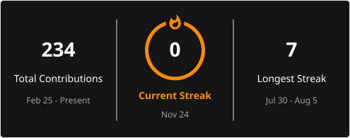

<!-- README.md — Kornu Venkata Santosh Kumar -->
<!-- Optimised for: GitHub profile, ATS systems, recruiters in DS/ML/AI/Analytics -->

<div align="center">


</div>

---

<div align="center">

[](https://venkatakornu-eng.github.io/)
[](https://www.linkedin.com/in/venkata-santosh-kumar-kornu-675009232)
[](mailto:venkatakornu@gmail.com)
[](#)
[](#)

</div>

---

## 👤 Professional Summary

> **MSc Data Science graduate (Merit, University of Leicester)** building and evaluating applied AI systems. My dissertation with **SmartViz** produced an AI-powered building analytics assistant (hybrid multi-agent LLM + local RAG) over **2.41 million time-series IDs**, raising exact-match accuracy from **10% to 100%** on a 10-prompt benchmark and cutting latency by **51.4%** against the full multi-agent design. Currently an **AI & Data Scientist Intern at Springer Capital**, developing PII detection and masking for an AI compliance-review application. Previously a Data Analytics Intern at **Vodafone Idea Foundation (_VOIS)**.

```python
profile = {
    "name"        : "Kornu Venkata Santosh Kumar",
    "degree"      : "MSc Data Science (Merit) — University of Leicester, UK",
    "background"  : "B.Tech ECE — IIIT Kalyani, India",
    "experience"  : [
        "AI & Data Scientist Intern @ Springer Capital (Sep 2026 – Present)",
        "Data Analytics Intern @ Vodafone Idea Foundation (_VOIS) (Oct 2025)",
    ],
    "focus"       : ["Applied ML", "LLMs & RAG", "Multi-Agent AI", "Building Analytics"],
    "seeking"     : "Data Scientist | AI Engineer | ML Engineer | Data Analyst — UK & Global",
    "availability": "Immediate · Open to Remote / Hybrid / Relocation",
    "visa"        : "UK Student Visa (Tier 4) · PSW Graduate Visa Eligible",
}
```

---

## 🎯 Current Focus

| Area | What I'm Building |
|------|-------------------|
| 🏢 **Building Analytics** | Natural-language analytics over smart-building sensor data (CO₂, temperature, humidity, occupancy) |
| 💬 **LLMs, RAG & Agents** | Hybrid multi-agent LLM systems with deterministic guards; local RAG with FAISS, Sentence Transformers and Ollama |
| 🔐 **Responsible AI** | PII detection and masking before documents reach external LLMs; evaluation sets with abstention on unsupported questions |
| 🤖 **Machine Learning** | Classification, regression and time-series models (scikit-learn, XGBoost, PyTorch, TensorFlow) |
| 📊 **Analytics & BI** | Interactive dashboards with Tableau, Power BI & Excel |

---

## 🚀 Featured Projects

### 🏢 [SmartViz: Multi-Agent LLM Analytics & Documentation RAG Assistant](https://github.com/venkatakornu-eng/building-intelligence-ai)
> **MSc Dissertation · University of Leicester × SmartViz · Building Analytics · Multi-Agent LLM · RAG**

- Cleaned, merged and profiled building time-series and space-hierarchy data: **2.41M unique time-series IDs, 30 metric types, 152 geometry IDs**, with ~**98%** room-mapping coverage for CO₂, temperature and humidity and **88%** for occupancy
- Raised exact-match accuracy of structured outputs from **10% (raw LLM) to 100%** (LLM + deterministic parser and guards) on a 10-prompt benchmark, adding only **0.17 s** mean latency
- Benchmarked three architectures on 12 controlled queries: simple hybrid **5/12** guard-valid (32.8 s), full multi-agent **12/12** (74.6 s), optimised hybrid **12/12** (36.3 s mean, 44.6 s P95, 1.92 LLM calls per query), a **51.4%** latency reduction
- Built a local documentation RAG pipeline (4 PDF guides, 21 pages, 22 chunks, all-MiniLM-L6-v2 384-dim embeddings, FAISS, Qwen2.5:7B via Ollama) with source/page citations and abstention; **10/10** evaluation tests passed (8 answerable, 2 unsupported questions correctly refused)
- Verified analytical outputs: date-range fix (2,536 rows) and a correlation audit of 23,194 same-room, same-timestamp pairs across 19 rooms (r = 0.037), without causal claims
- *Scope: controlled test sets (10–12 prompts, 10 documentation questions); results show design trade-offs, not general performance.*
- `Python` · `Pandas` · `SQL Server` · `FAISS` · `Sentence Transformers` · `Ollama` · `Qwen2.5:7B` · `Plotly` · `Power BI` · `Multi-Agent LLMs` · `RAG`

---

### 🛡️ [FraudSentinel — Full-Stack Fraud Detection System](https://github.com/venkatakornu-eng/FraudSentinel)
> **Financial ML · REST API · ML + Generative AI**

- Built a full-stack fraud detection system (Flask backend, REST API, live transaction feed, interactive dashboard)
- Trains and compares four models (Random Forest, XGBoost, Decision Tree, Logistic Regression) on **75,000 transactions**, reaching a **ROC-AUC of ~0.91** with the best model
- Integrated the Anthropic Claude API to generate plain-language alert narratives for high-risk transactions
- `Python` · `Flask` · `Scikit-learn` · `XGBoost` · `REST API` · `Anthropic Claude API`

---

### 🏛️ [Birmingham Council Spending Analysis](https://github.com/venkatakornu-eng/birmingham-spending-analysis)
> **Public Sector Analytics · Data Wrangling · Business Intelligence**

- Cleaned and reconciled **213,000+ transaction records** across multiple council departments
- Built an interactive Excel dashboard with Pivot Tables, KPI cards, and department-level drill-downs
- Surfaced that Housing accounted for **26% of total council spend** — actionable for budget planning
- `Excel` · `Pivot Tables` · `Data Wrangling` · `EDA` · `Data Storytelling`

---

### 🚦 [Data-Driven Traffic Prediction (LSTM · GRU · MLP)](https://github.com/venkatakornu-eng/Data-Driven-Traffic-Prediction-using-Machine-Learning-and-Artificial-Intelligence-)
> **Deep Learning · Time Series Forecasting · Neural Architecture Comparison**

- Designed and benchmarked three deep learning architectures on real traffic sensor data
- Implemented early stopping, learning-rate scheduling, and systematic hyperparameter optimisation
- Reduced **RMSE by 15%** vs baseline; achieved **89% prediction accuracy** across test sequences
- `Python` · `PyTorch` · `LSTM` · `GRU` · `MLP` · `Time Series`

---

### 🔬 [Breast Cancer Prediction using Machine Learning](https://github.com/venkatakornu-eng/Breast-Cancer-Prediction-using-Machine-Learning)
> **Healthcare ML · Classification · Ensemble Methods**

- Led a 3-person team benchmarking Logistic Regression, Random Forest, SVM, and Neural Networks on clinical data
- Applied **SMOTE oversampling**, k-fold cross-validation, and grid search hyperparameter tuning
- Achieved **96% classification accuracy** with high recall — minimising false negatives critical in medical diagnosis
- `Python` · `Scikit-learn` · `TensorFlow` · `SMOTE` · `Matplotlib`

---

### 🌍 [European Greenhouse Gas Emissions Analysis](https://github.com/venkatakornu-eng/Europe-emission-analysis)
> **Statistical Analysis · Hypothesis Testing · R**

- Applied correlation analysis, linear regression and t-tests to Eurostat emissions data to test for significant trends and differences between countries
- `R` · `Hypothesis Testing` · `Regression` · `EDA`

---

### 🩺 [Diabetes Risk Modelling](https://github.com/venkatakornu-eng/Diabetes-Risk-Modelling)
> **Healthcare Analytics · Clinical ML · AUC-ROC Optimisation**

- Developed a supervised classification pipeline for early diabetes risk stratification
- Applied data imputation, feature selection, and comparison across Logistic Regression, RF, and GBM
- Evaluated on AUC-ROC and precision-recall curves for clinical reliability
- `Python` · `Scikit-learn` · `Gradient Boosting` · `EDA` · `Feature Engineering`

---

## 🛠️ Technical Skills

### 💻 Programming Languages


### 🤖 Machine Learning & AI


**Methods:** `Regression` · `Classification` · `Clustering` · `LSTM` · `GRU` · `CNN` · `NLP` · `Time Series` · `Feature Engineering` · `Hyperparameter Tuning` · `Cross-Validation` · `SMOTE` · `Hypothesis Testing` · `Ensemble Methods`

### 💬 LLMs & Agentic AI


**Methods:** `RAG` · `Multi-Agent LLM Systems` · `Hybrid LLM + Deterministic Guards` · `Local LLM Inference` · `LLM / RAG Evaluation` · `PII Detection & Masking` · `Prompt Engineering`

### 🗄️ Databases & Backend


### 📊 Data Visualisation & BI


### 🧰 Tools


---

## 📜 Certifications

| Badge | Certification | Issuer | Year | Verify |
|-------|--------------|--------|------|--------|
| 🟢 | **Data Analytics Job Simulation** | Deloitte Australia · Forage | 2025 | [View](https://www.linkedin.com/in/venkata-santosh-kumar-kornu-675009232/details/certifications/) |
| 🟣 | **AI-Powered Data Analytics Simulation** | Tata Group · Forage | 2025 | [View](https://www.linkedin.com/in/venkata-santosh-kumar-kornu-675009232/details/certifications/) |
| 🔵 | **Introduction to Data for Decision Makers** | BCG · Forage | 2025 | [View](https://www.theforage.com/completion-certificates/SKZxezskWgmFjRvj9/Pchc5rEGyCeozqY5Z_SKZxezskWgmFjRvj9_Nnuk6hNLyZYYwBq6v_1777148133164_completion_certificate.pdf) |
| 🟡 | **Risk Job Simulation** | Goldman Sachs · Forage | 2025 | [View](https://www.theforage.com/completion-certificates/MBA4MnZTNFEoJZGnk/ETGMhLB5eCrYjcH8o_MBA4MnZTNFEoJZGnk_Nnuk6hNLyZYYwBq6v_1776364991394_completion_certificate.pdf) |
| 🔴 | **Python for Everybody Certification** | Coursera | 2025 | [Verify](https://www.coursera.org/account/accomplishments/verify/8RFPBQ2ZTE7J) |

---

## 🎓 Education

```
🏛️  MSc Data Science (Merit)
    University of Leicester · Leicester, UK · 2025–2026
    Modules: Statistics · Modelling Data · Advanced Machine Learning
             Data Science Practice · NLP & System Design
    Dissertation: Multi-agent LLM analytics & RAG assistant, with SmartViz

🏛️  B.Tech — Electronics & Communication Engineering
    IIIT Kalyani · West Bengal, India · 2021–2025
    GPA: 7.40 / 10

📘  Higher Secondary (MPC)
    Sri Chaitanya Junior Kalasala · Hyderabad, India · 2019
    GPA: 9.34 / 10
```

---

## 💼 Experience

```
🤖  AI & Data Scientist Intern
    Springer Capital · Remote, UK · Sep 2026 – Present

    ▸ Contributing to an AI-powered Compliance Document Review application
      for financial compliance workflows (document analysis, risk identification,
      evidence-based review)
    ▸ Developing a PII detection and masking service that identifies names,
      emails, phone numbers, financial identifiers and account details before
      documents reach external AI systems
    ▸ Working on secure tokenisation, document-level mappings and request
      interception to reduce exposure of sensitive data to external LLMs
    ▸ Supporting AI-assisted compliance workflows: potential regulatory
      violations, missing disclosures, precedent retrieval, output evaluation

📊  Data Analytics Intern — AI & Large Language Models
    Vodafone Idea Foundation (_VOIS) · Remote · Oct 2025

    ▸ Analysed a science and technology dataset as part of a 5-student team,
      generating data-driven insights and a written report
    ▸ Analysed further datasets using AI/ML approaches — data processing,
      feature engineering and modelling

🔬  Research Team Lead — MSME Communication Barriers Study
    Academic Research Project · 2024

    ▸ Led a 5-member cross-functional team investigating communication
      inefficiencies in the textile non-woven MSME sector
    ▸ Designed and distributed 72 structured professional surveys
    ▸ Delivered statistical insights and actionable recommendations to industry
```

---

## 📈 GitHub Statistics

<div align="center">
  <a href="https://git.io/streak-stats">
    
  </a>
</div>

## 📊 GitHub Analytics

<div align="center">


<br>


</div>

---

## 🏆 Achievements & Recognition

- 🎓 **MSc Data Science (Merit)** — University of Leicester, UK (2025–26)
- 🏢 **Industry Dissertation** — Built an AI building-analytics assistant in collaboration with SmartViz
- 📈 **10% → 100% Exact-Match Accuracy** — hybrid LLM + deterministic guards vs raw LLM (10-prompt benchmark)
- ⚡ **51.4% Latency Reduction** — optimised hybrid vs full multi-agent (both 12/12 guard-valid on 12 queries)
- ✅ **10/10 RAG Evaluation Tests** — including 2 unsupported questions correctly refused
- 🗂️ **2.41M Time-Series IDs Profiled** — SmartViz building sensor data; **213,000+** council transactions analysed in Birmingham dashboard
- 🔐 **AI & Data Scientist Intern** — PII detection and masking for an AI compliance-review application (Springer Capital)
- 🔬 **Research Team Lead** — Directed a 5-member team across 72 industry surveys for MSME sector analysis
- 📊 **5 Industry Certifications** — Deloitte, Tata Group, BCG, Goldman Sachs, Coursera
- 💡 **96% ML Accuracy** — Breast cancer prediction system with high diagnostic recall
- 📉 **15% RMSE Reduction** — Deep learning traffic forecasting vs statistical baseline

---

## 🤝 Let's Connect

<div align="center">

I'm actively seeking **Data Scientist**, **AI Engineer**, **ML Engineer**, and **Data Analyst** roles across the UK and globally.

Available for **immediate start** · Open to **remote, hybrid, on-site, and relocation**

[](https://venkatakornu-eng.github.io/)
[](https://www.linkedin.com/in/venkata-santosh-kumar-kornu-675009232)
[](mailto:venkatakornu@gmail.com)

</div>

---

<div align="center">


<sub>📍 Leicester, UK &nbsp;·&nbsp; MSc Data Science (Merit) · University of Leicester &nbsp;·&nbsp; UK Tier 4 Visa · PSW Eligible</sub>

</div>
